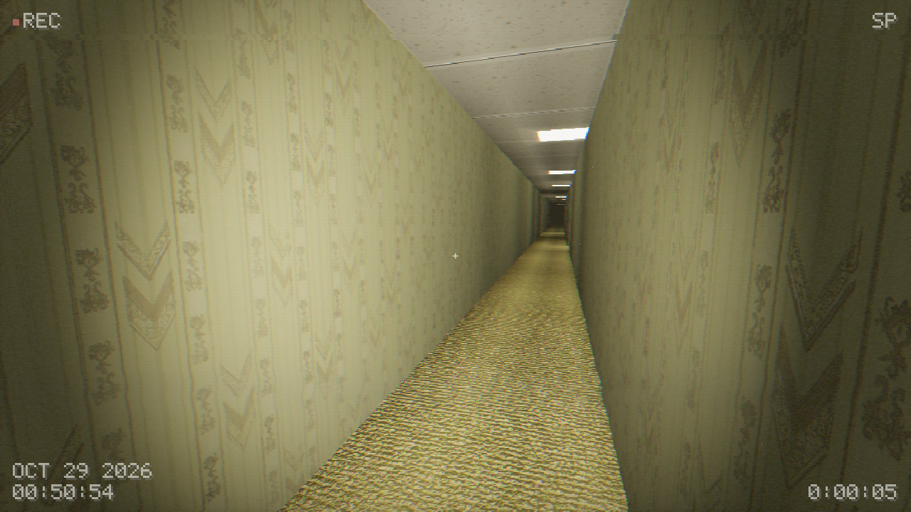
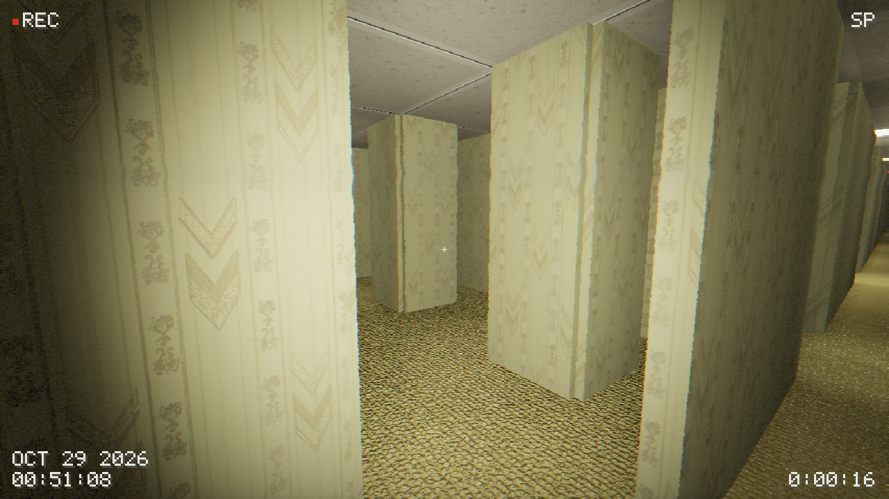
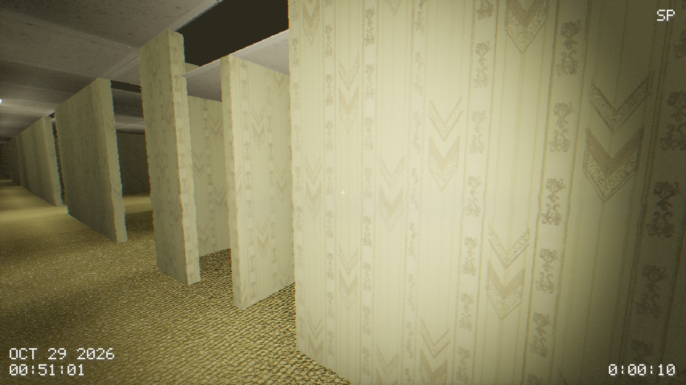
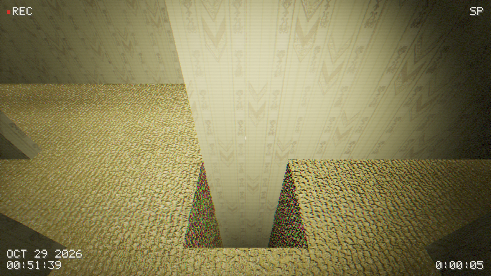
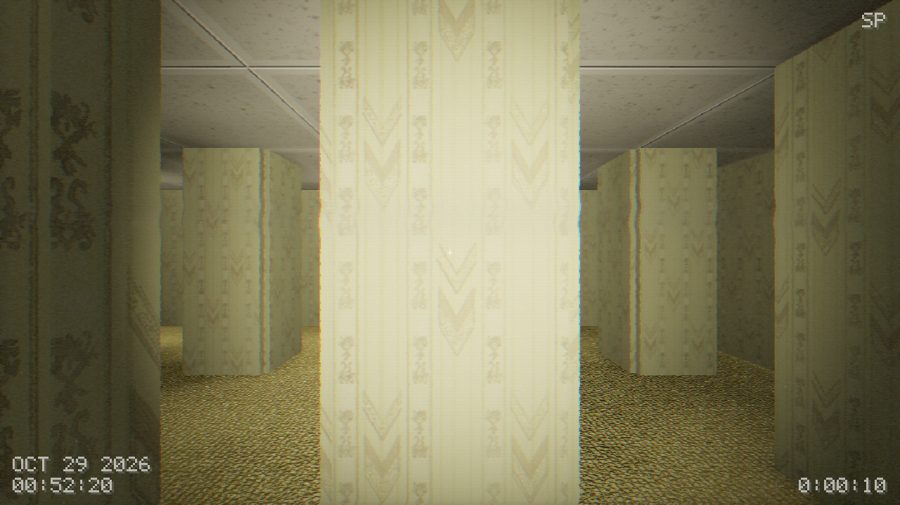
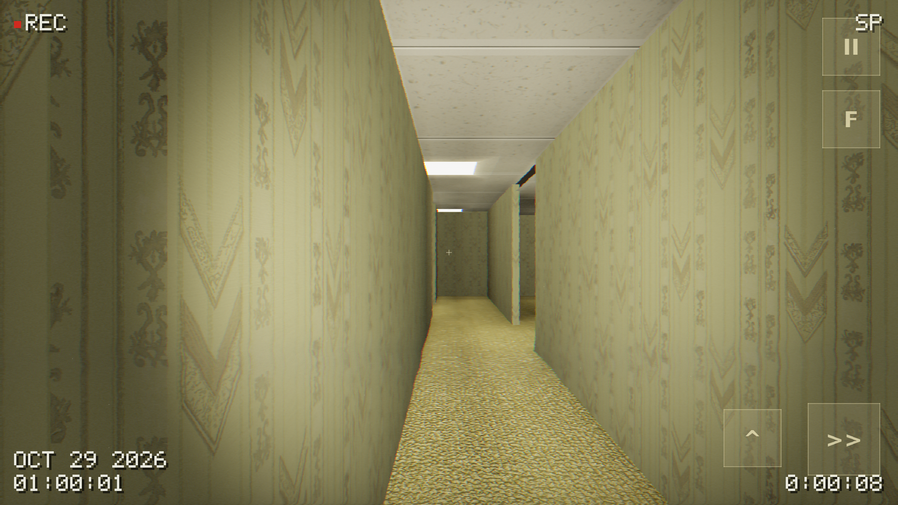
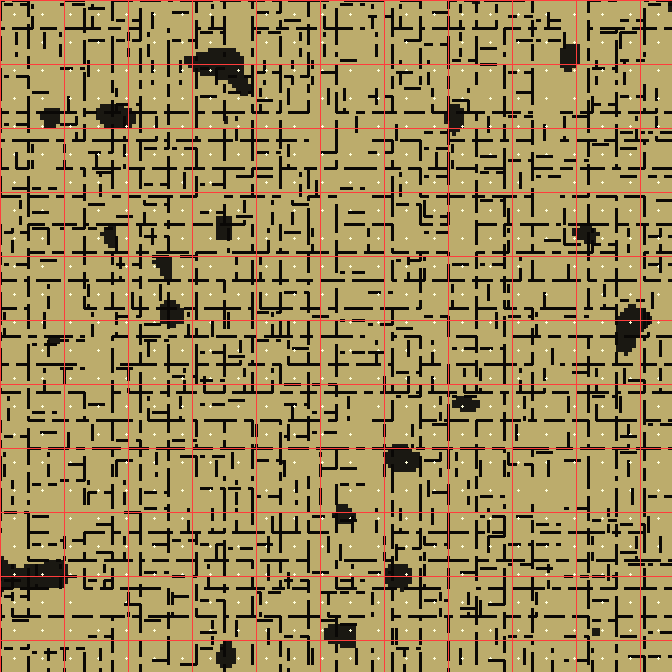

# The Backrooms — an infinite libGDX world for Android

An endless, procedurally generated Backrooms walker written in Java with [libGDX](https://libgdx.com).
You can walk (or run, or fall) in any direction forever: the level streams in around you and is
thrown away behind you, so the map never ends and memory never grows.




---

## What is in the box

| | |
| --- | --- |
| **Infinite map** | Built in two layers. **Lanes**: corridors two metres wide that run for a hundred metres or so and then stop dead in a wall, so the grid cannot be counted. **Blocks**: every 12 m square is one of seven kinds — offices of small rooms, an open hall, a forest of pillars, a grid of holes, terraces stepping down into the floor, a comb maze, or a grand hall with a four-and-a-half metre ceiling. Offices are still about six blocks in ten. Every wall, light, hole and terrace is a pure hash of its integer coordinates and the world seed, so any chunk can be generated on its own and always comes out the same. |
| **Streaming** | Chunks (16 × 16 m) are sampled, meshed and light-baked on background threads, uploaded at most two per frame, and released again behind you. Draw distance adjustable in game (2–6 chunks). |
| **Baked lighting** | Soft fluorescent pools, contact shadows in corners and a bounce pass, all baked per chunk at 2 texels/m into an 8 KB lightmap (irradiance on floors in RGB, on walls in alpha). Zero dynamic lights at runtime. |
| **Materials** | The CC0 wallpaper, carpet and ceiling tile sets with their normal maps (normal-mapped, specular, parallax-free), plus procedural fluorescent panels that flicker: a diffuser gradient across the panel, and an additive halo pass that blooms the light past the tube so it reads as a light rather than a white rectangle. |
| **Lighting model** | Warm fluorescent tubes, a handheld torch cone, distance haze, ACES tone mapping, vignette and a touch of sensor grain. |
| **VHS camcorder** | The whole frame goes through an offscreen pass that emulates tape — a *good* tape in a working deck: geometry straight to within a pixel, a little chroma smear from the low chroma bandwidth, a tracking band that nudges rather than tears, soft grain, faint scanlines and a warm slightly-lifted grade. Plus a camcorder OSD (REC lamp, SP, date, tape counter) drawn from a hand-built 5x7 character generator, and synthesised tape hiss. Toggle it in the pause menu (`VHS LOOK`) or with `-Dbackrooms.vhs=0`. |
| **The presence** | Something else is in here. Most of the time there is nothing at all. Eventually a figure appears ten to eighteen metres ahead of where you are looking, on the far side of a wall so you never see it arrive; it walks across the corridor ahead of you at a stroll, and keeps walking until another wall takes it out of your sight - only then does it go, and not again for half a minute or more. It never runs, never chases and cannot catch you: it is a silhouette in the shape of a person, solid black and featureless, and what it does is make you doubt what you saw. Toggle it in the pause menu (`THE PRESENCE`). |
| **Audio** | Everything is synthesised in `tools/make_assets.py`; no third-party samples. Footsteps pick a sample at random, then *echo off the room they happen in*: eight rays measure the walls around you, the nearest two surfaces become early reflections (delayed by distance and panned to the side they came from) and the average distance sets a diffuse tail, so a corridor snaps and a hall rings. The entity's steps are placed, panned, muffled through walls and echo the same way, and every so often it makes one of its own noises — a creak of something heavy leaning on a wall, chittering, something dragged, its breathing — each placed in the level, and harder to muffle than a footstep should be. The only room sound is the fluorescent buzz of the nearest working tube, fading in with distance; the tape hiss belongs to the camcorder. |
| **Controls** | Touch: floating stick on the left, drag-to-look anywhere on the right, run (hold), jump, torch and pause buttons — all fingers at once. Keyboard and mouse also work (desktop build). The emulator job drives the real controls and checks the numbers the app logs, so a dead button or a dead look drag fails CI instead of shipping. |
| **Platforms** | Android (`minSdk 24`, arm64 + armv7 + x86_64) and a desktop launcher used for development and screenshots. |

## Screenshots

Rendered by CI on software OpenGL (llvmpipe), 1280×720, seed 20241027:



A hole in the carpet — they are not rare, and falling in is how the level moves you somewhere else:



And the thing in the corridor (`-Dbackrooms.entity=1`):



Captured by CI from the real Android build on an API 30 emulator (touch controls):



`python3 tools/map_preview.py out.png 20241027 168` also draws a top-down plan of any seed:



---

## Building

### Requirements

* JDK 17
* Android SDK with platform 35 and build-tools (only needed for the APK)
* Nothing else — the Gradle wrapper is checked in

### APK

```sh
./gradlew :android:assembleDebug        # android/build/outputs/apk/debug/*.apk
./gradlew :android:assembleRelease      # unsigned release build
```

Install on a connected device:

```sh
adb install -r android/build/outputs/apk/debug/android-debug.apk
```

### Desktop (development)

```sh
./gradlew :desktop:run
```

Handy system properties for the desktop run:

| Property | Effect |
| --- | --- |
| `-Dbackrooms.autostart=1` | skip the title screen |
| `-Dbackrooms.seed=1234` | force a world seed |
| `-Dbackrooms.spin=1` | slowly rotate the view (used by the screenshot job) |
| `-Dbackrooms.yaw=45 -Dbackrooms.pitch=-7` | starting heading / pitch in degrees |
| `-Dbackrooms.spawn=0.5,-29.5` | drop the player at a known position (screenshots, debugging) |
| `-Dbackrooms.debug=1` | material colour view, magenta = hole in the geometry |
| `-Dbackrooms.hud=1` | show the performance readout |
| `-Dbackrooms.vhs=0` | render the raw frame without the camcorder pass |
| `-Dbackrooms.pit=1` | spawn on the rim of the nearest floor pit |
| `-Dbackrooms.entity=1` | pose the entity a few metres ahead for a screenshot (`0` removes it entirely) |
| `-Dbackrooms.capture=dir -Dbackrooms.frames=270` | render `frames` frames, dump PNGs into `dir`, quit |

### Tests

```sh
./gradlew :core:test
```

51 unit tests cover the generator (determinism, seeds, wall density, every kind of block, the
terraces being steps rather than ledges, corridors that run and corridors that stop, and that nine
tenths of the level around the spawn can actually be walked to), the mesher (winding, index bounds,
bounds, lightmap, the height of every kind of room), the light baker (occlusion, blockages),
the player physics (landing, thin-wall collision, 1200 steps of random walking without ever
clipping through a wall or sinking through the floor), the streaming that builds and releases
chunks, the shader rules that only bite on GLES2, the camcorder's 5x7 glyph table, the acoustics
(propagation delay, and that different rooms really do answer differently), and the entity's pass-by
rules: it appears out of sight and metres away, is seen while it walks, never moves faster than a
stroll, and only leaves once a wall has hidden it again.

### CI

`.github/workflows/android.yml` runs the tests, builds debug and release APKs on every push and
uploads them as artifacts; pushing a tag such as `v1.0.0` publishes both APKs to a GitHub release.
`.github/workflows/screenshots.yml` boots the desktop build under Xvfb with software GL, renders the
level and commits the PNGs in `screenshots/` (visual regression by eyeball); it fails instead of
committing if the world shader did not compile or a frame comes out blank.
`.github/workflows/emulator.yml` goes one step further: it boots a real Android emulator, installs
the APK, starts the launcher, waits, drives the touch controls, screenshots the result into
`screenshots/android/` and fails if the app is not running, never drew anything, or logged a crash.
Its diagnostics (emulator log, filtered logcat, shader compile log) are committed to
`docs/ci/emulator-report.md`.

To sign a release build, put these in the environment before running Gradle:
`BACKROOMS_KEYSTORE`, `BACKROOMS_KEYSTORE_PASSWORD`, `BACKROOMS_KEY_ALIAS`,
`BACKROOMS_KEY_PASSWORD`.

---

## How it works

```
core/src/main/java/com/backrooms/gdx
├── world/WorldGen.java        pure, stateless description of the level (no allocation)
├── world/ChunkSampler.java    fills a ChunkData (+1 cell border) from the generator   [worker]
├── chunk/ChunkMesher.java     visible faces only, one mesh per chunk                  [worker]
├── light/LightBaker.java      irradiance bake: fixtures, soft shadows, AO, bounce     [worker]
├── world/World.java           streaming, priority, upload budget, unloading           [render]
├── render/WorldRenderer.java  one shader, 6 tiled textures, one draw call per chunk
├── player/Player.java         first person movement, thin-wall capsule collision
├── input/TouchControls.java   floating stick, drag look, buttons, keyboard
├── entity/EntityController    the pass-by: where it appears, where it walks, when it goes (no GL)
├── entity/EntityRenderer      the rigged silhouette: walk clip #1, black material, fallback body
├── render/VhsEffect.java      offscreen buffer + the tape shader
├── ui/VhsOsd.java             camcorder OSD drawn from a 5x7 character generator
├── audio/Acoustics.java       probes the walls around a step and returns the room's answer
├── audio/AudioManager.java    muxer: placed footsteps, echo taps, buzz, tape hiss, its noises
└── ui/Hud.java, screens/…     title screen, HUD, pause menu (with an fps and chunk readout)
```

### The level

* **Floor** comes from two octaves of value noise; the upper tail becomes stair terraces, the lower
  tail becomes dips, and a second noise field punches the occasional deep hole. Heights are
  quantised to 25 cm so slopes turn into stair treads you can walk up.
* **Walls** live on the integer grid lines and are 16 cm thick. Room borders are walls with two-cell
  doorways; roughly one in six borders is missing entirely, which produces the big open halls of
  Level 0. About half of the rooms get a single internal divider with a gap.
* **Ceilings** follow the floor plus a room height that varies a little between 5-cell blocks; the
  differences are closed with vertical drop faces so you never see through a wall top.
* **Fluorescent fixtures** sit on one lattice point per room, a few sockets are empty and a few
  tubes are burned out or flicker.

Because everything is a function of the seed and the coordinates, chunks can be built in any order,
from any thread, and the world is infinite in every direction with no seams.

### The lighting

Per chunk the baker writes a 34 × 34 lightmap (2 texels per metre plus a border so neighbouring
chunks filter seamlessly):

1. for every texel, the nearby fixtures are attenuated by distance and visibility (a grid DDA that
   stops at walls, floors and ceilings);
2. an ambient occlusion term from five short probe rays;
3. a cheap one-bounce blur added back (light from the carpet filling the room);
4. sqrt encoding for gradient precision in the dark end.

The shader decodes it, applies normal mapping and specular from the diffuse/normal maps, adds the
torch cone, the panel emission with flicker, exponential haze, ACES tone mapping and a vignette.

### Optimisation notes

* one draw call per chunk, all six textures bound once per frame;
* faces between walls, risers under walls and geometry outside the chunk are never emitted;
* CPU frustum culling per chunk (13–18 of 37 loaded chunks drawn in the CI render);
* no dynamic lights, no shadow maps, no lighting recomputation at runtime;
* chunk build ≈ 27–51 ms on the CI runner's CPU, spread over up to two worker threads, two uploads
  per frame maximum;
* per-frame allocations in the hot path are avoided; bitmaps are uploaded once;
* geometry and tile UVs are stored **relative to their chunk** and the camera/torch positions are
  handed to the shader in that same local frame. Phones run fragment shaders at `mediump` (10 bit
  mantissa), so after a few hundred metres a world-space UV would be interpolated with centimetre
  error and the wallpaper would visibly tear; chunk-local values keep it exact.

On a mid-range phone the target is 60 fps with a 3 chunk radius; drop the radius in the pause menu
if your device needs it.

### Tuning knobs

| Constant | Where | Meaning |
| --- | --- | --- |
| `CHUNK_CELLS` | `WorldGen` | chunk edge in metres (16) |
| `BLOCK` | `WorldGen` | edge of a block, lane included (12 m) |
| `CORRIDOR_WIDTH` | `WorldGen` | width of a corridor lane (2 m) |
| `ROOM_MODULE` | `WorldGen` | size of an office room (3 m); two of its four walls open |
| `kindAt()` | `WorldGen` | the mix of block kinds — offices are about six in ten |
| `laneColumn()` / `laneRow()` | `WorldGen` | where corridors run, and how often they stop |
| `LIGHT_SPACING` / `LIGHT_PHASE` | `WorldGen` | fixture lattice |
| `ROOM_HEIGHT`, `CORRIDOR_CEIL`, `MAZE_CEIL`, `GRAND_CEIL`, `SUNKEN_CEIL` | `WorldGen` | ceiling of each kind of room |
| `HOLE_DEPTH` | `WorldGen` | how far the pits drop (6 m: you do not climb out) |
| `TERRACE_STEP`, `TERRACE_RINGS` | `WorldGen` | how a sunken room steps down (0.5 m, 4 rings) |
| `isHole()` | `WorldGen` | hole shape and density (about 4% of the floor) |
| `LIGHT_INTENSITY`, `FALLOFF`, `RANGE` | `LightBaker` | brightness, falloff and lightmap encoding |
| `TEXELS_PER_METER` | `LightBaker` | lightmap resolution (2) |
| `WALK_SPEED`, `SPRINT_SPEED`, `GRAVITY`, `JUMP_SPEED` | `Player` | movement feel |
| `fogDensity`, `exposure` | `PlayScreen` | haze and exposure |
| `SPAWN_MIN`, `SPAWN_MAX` | `EntityController` | how far ahead of the player it appears |
| `PASS_MIN`, `PASS_MAX` | `EntityController` | how far it walks across the view before a wall takes it |
| `STALK_SPEED` | `EntityController` | its walking pace — it never speeds up |
| `HIDDEN_TO_VANISH`, `GONE_MIN`, `GONE_MAX` | `EntityController` | seconds out of sight before it leaves, and how long it stays away |
| `scale` | `VhsEffect` | resolution of the tape buffer (0.85 of the screen by default) |
| `CUE_MIN`, `CUE_MAX` | `EntityController` | how often it makes one of its small noises |
| `WALK_CLIP_INDEX` | `EntityRenderer` | which animation it walks on (number one) |
| `u_scanline`, `u_intensity` | `VhsEffect` | how heavy the camcorder look is |

## Assets

* Textures: [amini-allight/backrooms-textures](https://github.com/amini-allight/backrooms-textures),
  CC0 1.0 — created and/or modified by Amini Allight.
* Everything else (audio, icons, font atlas) is generated by `tools/make_assets.py`.
* [gdx-gltf](https://github.com/mgsx-dev/gdx-gltf) (Apache-2.0) loads the rigged glTF model; it is
  the project's only third-party runtime dependency.
* See `assets/CREDITS.md`.

## Known limitations / next steps

* Frame rate on real phones is unverified: the emulator renders with a software rasteriser, so its
  numbers (≈4 fps at 1080×1920) say nothing about a GPU. The render distance menu item is the only
  quality switch.
* One GLSL ES trap is worth remembering: a uniform declared in both shader stages must have the
  same precision, and a `precision` statement is ES-only (wrap it in `#ifdef GL_ES`). Both rules are
  enforced by `ShaderPrecisionTest`, because a violation only shows up on the device.
* The second device-only trap is `mediump`: anything the fragment shader interpolates has to stay
  small, which is why chunk geometry is chunk-local. `ChunkMesherTest` guards it.
* The entity is the "Accurate Backrooms Bacteria v2 with Animations" model (CC-BY-4.0, credited in
  `assets/CREDITS.md`), converted by `tools/prepare_entity_model.*`. The conversion does three
  things the runtime cannot: it collapses the 135-joint rig to the 24 joints a GLES2 shader can
  hold, it drops a piece of staging geometry that was welded to the root joint, and it normalises
  the model to metres with its feet on the origin - a skinned mesh does not draw where its bounds
  say, so the size has to be measured where the skin can be evaluated. If the file is missing or
  fails to load, `EntityRenderer` falls back to a body built from boxes; see
  `assets/models/README.md`.
* The desktop build is a development tool, not a shipped target.
* Multi-threaded chunk building uses up to 2 workers; a job system would scale to more cores.
